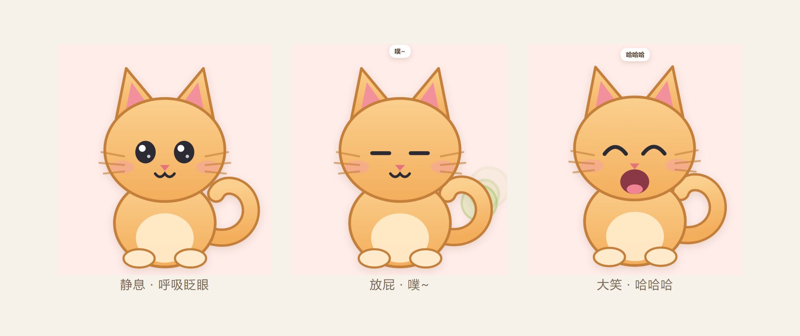

# 猫咪桌面萌宠 🐱

一只住在你桌面上的小猫咪。它会呼吸、会眨眼、会甩尾巴，还会——

- 💨 **放屁**：眯起眼睛，蹲下发力，屁股后面冒出一团绿色的云
- 😹 **大笑**：眼睛弯成两条弧线，张大嘴巴，整只猫蹦蹦跳跳



## 特性

| 特性 | 说明 |
| --- | --- |
| 透明无边框 | 只有猫，没有窗口框，也没有白色底板 |
| 始终置顶 | 永远浮在别的窗口上面 |
| **鼠标穿透** | 空白处点击直接穿透到下面的窗口，不挡你干活 |
| 可拖拽 | 按住猫身就能拖到屏幕任意位置 |
| 右键菜单 | 放屁 / 大笑 / 回到右下角 / 退出 |
| 零位图素材 | 整只猫是 SVG 画的，任意缩放都清晰，安装包不含图片 |
| 轻量 | 不做后台轮询，静息动画全部交给 CSS，CPU 基本闲置 |

## 下载安装

到 [Releases](../../releases) 页面下载，两种任选其一：

| 文件 | 说明 |
| --- | --- |
| `CatPet-Setup-1.0.0.exe` | **安装版**。双击安装，可选安装目录，自动创建桌面和开始菜单快捷方式 |
| `CatPet-Portable-1.0.0.exe` | **便携版**。免安装单文件，双击直接跑，不写注册表，适合丢进 U 盘 |

> 因为没有购买代码签名证书，首次运行时 Windows SmartScreen 可能提示"未知发布者"。
> 点「更多信息」→「仍要运行」即可，这是未签名应用的正常现象。

## 怎么玩

| 操作 | 效果 |
| --- | --- |
| 左键点猫 | 随机触发「放屁」或「大笑」 |
| 按住左键拖动 | 把猫拖到任意位置 |
| 右键点猫 | 弹出菜单 |

拖动超过 5 像素才算拖拽，所以点击和拖动不会互相干扰。

## 从源码跑起来

```bash
npm install
npm start
```

## 自己打包

```bash
npm run dist      # 生成安装版 + 便携版，输出到 dist/
npm run dist:dir  # 只生成免安装目录，调试用（快很多）
```

图标不用外部素材，`npm run icon` 会用纯 Node 现场画出来（见下文）。

## 实现要点

### 1. 透明 + 鼠标穿透

窗口开 `transparent: true` / `frame: false` / `alwaysOnTop`（层级 `screen-saver`）。
默认调 `win.setIgnoreMouseEvents(true, { forward: true })` 让整窗鼠标穿透；渲染层用
`document.elementFromPoint()` 判断指针是否真的落在 SVG 的可见部分上，落到猫身上时才
通过 IPC 让窗口接管鼠标。这样既不会挡住桌面操作，猫本身又点得到。

### 2. 拖拽用屏幕绝对坐标

不用 `-webkit-app-region: drag`（它会吃掉点击事件），而是在 `mousedown` 记下
`screenX/screenY`，`mousemove` 时把**位移增量**发给主进程，主进程用
`拖动起点的窗口坐标 + 增量` 调 `setPosition`。这样窗口跟手，不会越拖越偏。

### 3. 三套五官叠放切换

猫的眼睛有三套（常态 / 大笑 `^^` / 眯眼），嘴巴有两套（`ω` / 张大）。全部画在 SVG 里
叠着，靠一个状态类切换 `opacity`，配合 CSS `transition` 做 120ms 交叉淡入。

### 4. 动画全交给 CSS

呼吸、眨眼、甩尾、下蹲、蹦跳、屁云飘散都是 `@keyframes`，JS 只负责切状态和计时。
主进程开了 `backgroundThrottling: false`，窗口失焦时动画也不会被节流。

### 5. 图标零依赖生成

`tools/make-icon.js` 自己实现了 PNG 编码（zlib deflate + CRC32 + IHDR/IDAT/IEND）
和 ICO 封装（内嵌多尺寸 PNG），再用 3×3 超采样把猫头光栅化出来。整个项目
**不依赖任何图形库**，也不用准备任何图片素材。

## 项目结构

```
cat-desktop-pet/
├── main.js              # 主进程：窗口、穿透、拖拽、右键菜单
├── preload.js           # contextBridge 暴露最小 IPC 接口
├── src/
│   ├── index.html       # 猫咪 SVG（三套眼睛 / 两套嘴巴）
│   ├── style.css        # 静息 + 放屁 + 大笑 全部动画
│   └── cat.js           # 状态机 + 交互
├── tools/
│   └── make-icon.js     # 纯 Node 生成 icon.ico
├── build/
│   ├── icon.ico
│   └── icon.png
└── docs/
    └── preview.png
```

## 环境要求

- Windows 10 / 11（x64）
- 从源码跑需要 Node.js 18+

## 许可

[MIT](LICENSE)
